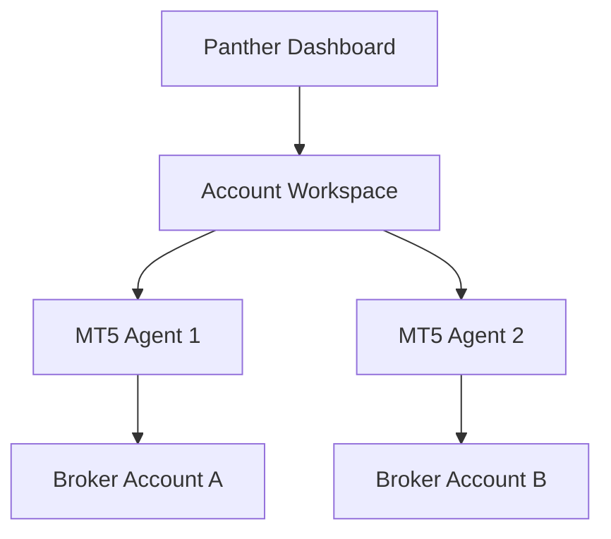

# Panther commercialization plan

Panther can be sold as a trading tool, but it must be positioned as decision-support and automation software, not as guaranteed profit software. The strongest product angle is proof, discipline, and execution control: Panther scans markets, manages risk, explains why a trade is allowed or blocked, and records evidence before live deployment.

## Product shape

The practical product should support three tiers.

| Tier | Customer | What they get | Execution model |
| --- | --- | --- | --- |
| Panther Desktop | Individual traders | Local dashboard, MT5 connector, scanner, demo/live guard, notifications | Runs on their Windows PC or VPS |
| Panther Pro | Serious traders | Multi-account workspace, strategy journal, performance reports, stricter risk controls | Local MT5 terminals connected to one dashboard |
| Panther Cloud Control | Power users / small groups | Hosted account portal, license management, remote dashboards, analytics | Local execution agent plus cloud account management |

## Multi-account design

Yes, Panther can be built to connect to multiple trading accounts, but execution should stay isolated per account.

A safe architecture is:

Each account needs its own broker session, account hash, risk limits, trade history, green-flag status, and emergency stop. A winning demo account should not automatically unlock a different customer account.

## What to build before selling

Before selling to strangers, Panther needs:

- license keys and per-device activation
- onboarding wizard for MT5 connection
- account-level risk settings
- read-only demo mode by default
- legal terms, risk disclaimer, and no guaranteed-return language
- audit log for every signal, approval, rejection, order, close, win, and loss
- auto-update script so users do not manually type commands
- support workflow for logs and screenshots
- broker compatibility matrix
- paid beta group with strict feedback collection

## Hype plan

The hype should be built around visible proof, not income claims.

1. Build in public with short clips of Panther scanning 50+ markets, explaining blockers, and managing demo trades.
2. Publish weekly transparent demo reports: trades, win rate, profit factor, drawdown, best markets, worst markets.
3. Show the green-flag meter improving over time.
4. Create “Panther blocked this bad trade” content, because avoiding bad trades is a strong trust angle.
5. Offer a limited beta waitlist for traders who already use MT5.
6. Turn the first beta users into case studies only after verified broker statements or audited exports.

The commercial promise should be: Panther helps traders scan faster, control risk, document strategy evidence, and execute with discipline. Profit claims must come only from verified performance data.
